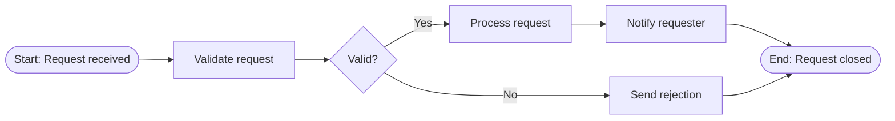

# /business-process-modeling — BPMN Process Modeling

## Step 1: Define Process Scope

State clearly:
- **Process name** (verb + noun: "Process Insurance Claim")
- **Trigger** (what starts the process)
- **End state** (what a successful completion looks like)
- **Participants / Swim lanes** (roles or systems involved)
- **AS-IS or TO-BE** (current state or desired future state)

## Step 2: Identify Process Elements

| BPMN Element | Symbol | When to use |
|---|---|---|
| Start Event | ○ | Process trigger |
| End Event | ◉ | Process completion |
| Task | □ | An atomic unit of work |
| User Task | 👤□ | Human performs the work |
| Service Task | ⚙□ | Automated / system action |
| Gateway (XOR) | ◇ | Exclusive decision |
| Gateway (AND) | ◆ | Parallel split or join |
| Sub-Process | ⊞ | Collapsible complex activity |
| Message Flow | - - → | Communication between pools |

## Step 3: Draw the Process (Mermaid)

Use Mermaid flowchart as a lightweight BPMN approximation:

## Step 4: Annotate Key Points

For each decision gateway, document:
- Decision rule (business rule that drives the branch)
- Data needed to evaluate the rule

For each task, document:
- Actor (human role or system)
- Estimated cycle time (if known)
- Systems/tools used

## Step 5: Validate with Stakeholders

- [ ] All swim lanes / actors identified
- [ ] Every path from Start to End is complete (no dead ends)
- [ ] Business rules at gateways are explicit
- [ ] Exceptions and error paths documented
- [ ] Stakeholder sign-off obtained before progressing to requirements
