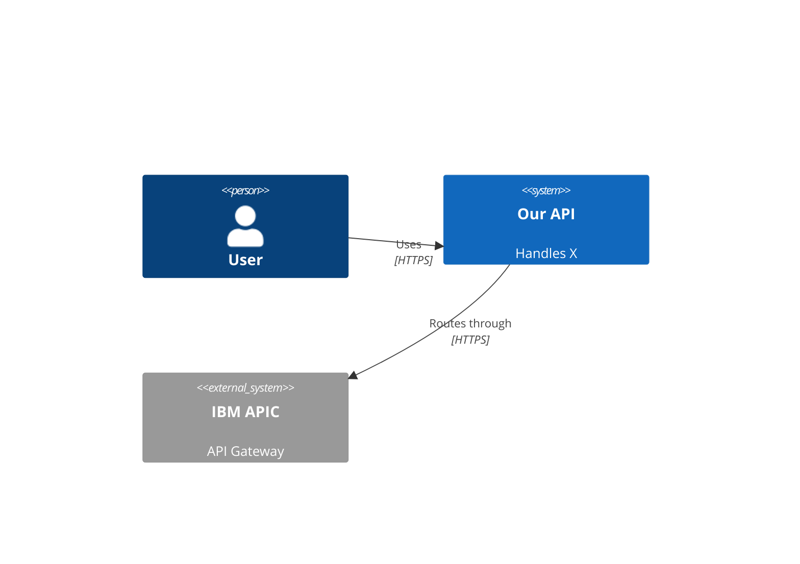

# /document — Documentation Update Workflow

## Step 1: Identify What Changed

```bash
# Changed files since last commit or in staging
git diff --name-only HEAD~1 2>/dev/null || git diff --name-only --cached 2>/dev/null || git status --short

# Recent commits
git log --oneline -10 2>/dev/null
```

Also read `.claude/memory/team-findings.md` — other agents write discoveries there that need to be promoted to permanent documentation.

## Step 2: Assess Documentation Impact

For each changed file, determine what docs need updating:

| Change Type | Documentation Action |
|-------------|---------------------|
| New module / feature | Update CLAUDE.md architecture section |
| New data store / collection / table | Update CLAUDE.md data stores section |
| New build / test / deploy command | Update CLAUDE.md quick start + commands |
| Architecture decision | Create ADR in `docs/adr/NNNN-title.md` |
| New external integration | Update domain docs + integration table in CLAUDE.md |
| New pipeline step | Update `docs/operations/` runbook |
| New dependency | Note in CLAUDE.md tech stack table |
| Breaking API change | Create ADR + update README + notify in team-findings.md |
| New environment variable | Add to CLAUDE.md env vars table (name only, never value) |

## Step 3: Consolidate team-findings.md

Before updating permanent docs, process `.claude/memory/team-findings.md`:

1. Read all entries
2. For each entry:
   - If it belongs in CLAUDE.md → add to the relevant section, delete the entry
   - If it's a temporary note (resolved bug, one-off) → delete it
   - If it's still pending (another agent needs to act) → leave it
3. Save the cleaned file

Only permanently documented information should be removed from `team-findings.md`.

## Step 4: Update CLAUDE.md

Read the current `CLAUDE.md` to understand its structure before editing.

Rules:
- **Minimal edits** — update only what changed, do not rewrite accurate sections
- **Scannable format** — use tables and bullet points, not paragraphs
- **No duplication** — if it's in README, reference it rather than copying
- **No secrets** — env var names only, never values

Priority update order:
1. Architecture / module table (new modules added)
2. Integration points table (new external connections)
3. Quick start / commands (build, test, deploy commands changed)
4. Tech stack table (new dependencies)
5. Known gotchas (agent discoveries from team-findings.md)
6. Agent notes (new per-agent instructions)

## Step 5: Create / Update ADRs

Create an ADR (`docs/adr/NNNN-title.md`) when:
- A technology was chosen over alternatives
- A pattern was adopted project-wide
- An integration approach was decided
- A data model change was made
- A security or compliance decision was taken

Find the next ADR number:
```bash
ls docs/adr/ 2>/dev/null | grep "^[0-9]" | sort | tail -1
```

ADR template:
```markdown
# NNNN — Title

## Status
Accepted | Proposed | Deprecated | Superseded by NNNN

## Context
What problem or constraint led to this decision?

## Decision
What was decided? Be specific.

## Consequences
What becomes easier? What becomes harder or riskier?
```

Keep each section to 2–4 sentences. No verbose prose.

## Step 6: Update Diagrams (if applicable)

When architecture or integration flows change, update or create Mermaid diagrams:

```markdown
# C4 Context Diagram (in docs/architecture/context.md)

```

Diagrams live in `docs/architecture/`. Name them `context.md`, `container.md`, `component-<name>.md` following the C4 model levels.

## Step 7: Update Other Docs

- **`README.md`** — Only if setup prerequisites, install steps, or quick start changed
- **`docs/domain/`** — If domain concepts, glossary, or integration patterns changed
- **`docs/operations/`** — If deployment, monitoring, or runbook procedures changed
- **`CHANGELOG.md`** — Add entry for this release cycle if one is pending

## Step 8: Report

```
## Documentation Updated

### Files Modified
- `CLAUDE.md` — Updated: <sections: architecture table, env vars, gotchas>
- `docs/adr/0005-use-redis-cache.md` — Created: chose Redis over in-memory for cross-instance cache sharing
- `docs/architecture/context.md` — Updated: added APIC gateway to context diagram

### team-findings.md
- Consolidated: X entries promoted to CLAUDE.md
- Removed: X resolved/stale entries
- Remaining: X entries still pending action by other agents

### No Update Needed
- README.md — No changes to setup or prerequisites
- docs/operations/ — No pipeline changes
```
