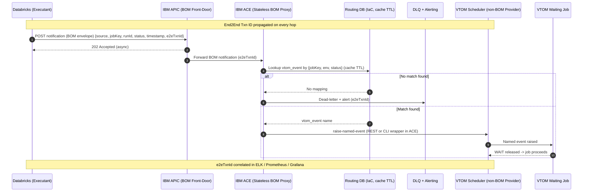

# /pattern-diagram-design — TCS Integration Pattern Diagrams

Generate Mermaid diagrams for TCS integration patterns, aligned to the ARCHI Enterprise
Architecture catalog (which follows Gregor Hohpe's *Enterprise Integration Patterns* vocabulary).
The ARCHI pattern pages are thin metadata tables whose visuals are drawio macros that do not
export to text — so this skill reconstructs the diagrams as Mermaid from the characteristics
table plus EIP vocabulary.

---

## Step 1: Identify the pattern

Determine which catalog pattern applies. If the user has not named one, run the decision guide
(Step 2). Match against the catalog:

| Pattern | Purpose | Mermaid type | Key participants / notation |
|---|---|---|---|
| Sync Standard (MsgIntPat1) | Blocking request/reply, response needed inline | `sequenceDiagram` | Consumer→APIC→ACE→Provider; synchronous 200; blocking activations |
| Proxy with error interpretation | Sync proxy mapping provider faults to BOM errors | `sequenceDiagram` | `alt` success/error; error-mapping note at ACE |
| Proxy-Pure | Sync pass-through proxy, faults unchanged | `sequenceDiagram` | thin ACE participant; no transform note |
| Async Standard (MsgIntPat2) | Fire-and-forget, decoupled from execution | `sequenceDiagram` | 202 Accepted; channel; DLQ; correlation note |
| Async Exception 1 (Provider not BOM) | Provider not BOM-native → ACE is BOM proxy/translator | `sequenceDiagram` | BOM boundary at APIC; non-BOM confined to ACE↔Provider via `Note over` |
| Channel - no API in BOM | Channel reaches backend with no BOM API | `sequenceDiagram` / `flowchart` | channel adapter; BOM facade at ACE |
| API cache + backend-validation | Serve from cache, validate against backend | `sequenceDiagram` | cache participant; `alt` hit/miss; TTL note |
| Message Retry / Replay | Recover failed/lost messages | `sequenceDiagram` | DLQ + MOEx Record/Replay; retry loop |
| API translator location | Decide where BOM↔non-BOM translation runs | `flowchart` | boundary box around ACE proxy; placement nodes |
| Routing & Orchestration – Single call | Data-driven single-target routing lookup | `sequenceDiagram` | Routing DB participant; cache TTL; data-driven (not code) note |
| Managed File Transfer (MFT) | Governed/monitored file movement | `flowchart` / `sequenceDiagram` | MFT agent nodes; endpoints; checkpoint/audit |
| File Transfer | Plain file movement | `flowchart` | source→transport→target |
| ETL | Transform before load | `flowchart LR` | Extract→Transform→Load; staging store |
| ELT | Transform in target | `flowchart LR` | Extract→Load→Transform-in-warehouse |
| Integration processing rules classification | Classify processing into sanctioned vs non-compliant | table + `flowchart` | rule-type nodes; compliant vs flagged (e.g. Dynamic mapping) |

---

## Step 2: How to choose a pattern (decision guide)

1. **Data-at-rest or a message/call?** Files/datasets → go to step 2. A message or call → go to step 3.
2. **Files.** Governed transfer (monitoring / audit / control plane) → **Managed File Transfer**;
   plain movement → **File Transfer**; need transform → **ETL** (transform *before* load, engine
   *outside* the target) vs **ELT** (load raw, transform *inside* the warehouse).
3. **Does the consumer need the response inline?** Yes → **Sync Standard**. No / fire-and-forget →
   **Async Standard** (return `202 Accepted`).
4. **Is the provider BOM-native?** Yes → bare Sync/Async standard. No → insert ACE as a BOM proxy:
   **Async Exception 1** (async) or a Proxy sub-pattern (sync: **Proxy-Pure** for pass-through,
   **Proxy with error interpretation** if faults must map to BOM errors). Keep non-BOM vocabulary
   confined to the ACE↔Provider hop; keep the consumer/APIC boundary BOM.
5. **Any processing beyond pass-through?** Classify via **Integration processing rules**: a
   single-target lookup is **Routing & Orchestration – Single call**, compliant ONLY if it is
   data-driven in an IaC DB (never *Dynamic mapping* in ACE code — non-compliant with "API
   independence from source"). Layer **Additional options** (cache + backend-validation,
   Retry/Replay, translator-location) and document each.

---

## Step 3: Author the System-Process page

A System-Process (SP) page follows this section order:

1. **Status**
2. **When to use**
3. **Pattern characteristics table** — columns: Generic type · Code · Message construction ·
   Channel options · Synchronicity · Orchestration · Description · Downside · TCS Examples
4. **Pattern black-box view**
5. **Sequence diagram**
6. **Implementation diagram**

### End2End System Process
- Page labelled `End2End_SP`, created from the template, stored in the **System Process Repository**
  (Confluence), and tied to a **Jira EPIC**.

### SP naming convention
- `SP Consumer - <app> - <api>`
- `SP Provider - <app> - <api>`
- `SP Consumed - <api>`

### Jira linkage
- **EPIC** = End2End
- **USER STORY** = consumer solution requirement
- **API STORY (NIPO)** = consumed / provider API

---

## Step 4: Apply the required robustness elements

Every SP diagram MUST show:

- **DLQ + retry** — Dead Letter Channel with a retry path.
- **End2End transaction ID correlation** — EIP *Correlation Identifier* propagated on *every* hop.
- **Record/Replay via MOEx** — recoverability of failed/lost messages.
- **End2End + Business Activity Monitoring** — observability of both technical and business flow.

---

## Diagramming & authoring conventions

- **Vocabulary.** Use EIP terms consistently: *Correlation Identifier*, *Dead Letter Channel*,
  *Message Router*, *Content Enricher*, *Channel Adapter*, etc.
- **BOM boundary.** Keep the consumer↔APIC boundary in BOM vocabulary. Confine non-BOM
  vocabulary to the ACE↔Provider hop, marked with a `Note over`.
- **Visual-macros caveat.** ARCHI pattern pages are thin metadata tables; their black-box,
  sequence, and implementation visuals are drawio macros that **do not export to text**. Author
  diagrams as Mermaid from the characteristics table + EIP vocabulary. Mark any visual you had to
  infer (rather than read from source) with **`[ASSUMPTION]`**.
- **Mermaid hygiene.** Use `autonumber` on sequence diagrams; name participants with their role
  (e.g. `ACE as IBM ACE (Stateless BOM Proxy)`); use `alt`/`else` for success/error and
  hit/miss branches; use `Note over` for cross-cutting concerns (correlation ID, observability).

---

## Worked example — Databricks → VTOM async trigger (Async Exception 1 + Routing)

This is the canonical reference: an async notification from a non-BOM executant (Databricks)
through the BOM front-door (APIC) and a stateless BOM proxy (ACE) that does a data-driven routing
lookup before raising a named event on a non-BOM provider (VTOM). Note the BOM boundary, the
data-driven routing DB (not code), DLQ + alerting, and the End2End transaction ID on every hop.

---

## Output

Deliver, for the chosen pattern:

1. The **pattern name** and a one-line rationale (cite the decision-guide step that selected it).
2. The **pattern characteristics table** (the 9 columns above), filled from the catalog.
3. The **Mermaid diagram(s)** of the type the catalog prescribes for that pattern — with the four
   required robustness elements present, EIP vocabulary, the BOM boundary marked, and any inferred
   visuals tagged `[ASSUMPTION]`.
4. The **SP page scaffold** (Status → When to use → characteristics → black-box → sequence →
   implementation) plus the SP names and Jira linkage when the user is producing an SP page.

Present diagrams inline as Mermaid code blocks. Do not attempt to export drawio macros.
