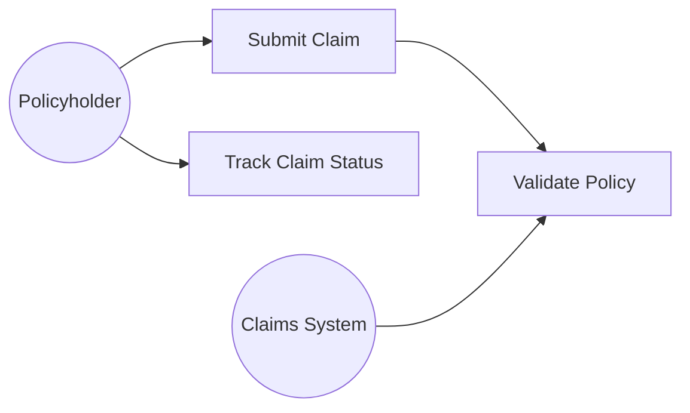

# /use-case-modeling — Use Case Specification

## Step 1: Identify Actors

An actor is any entity (human or system) that interacts with the system:
- **Primary actor** — initiates the use case (has a goal to achieve)
- **Secondary actor** — supports the interaction (e.g., external API, database)

List actors with their role and primary motivation.

## Step 2: Identify Use Cases

A use case = a goal a primary actor wants to achieve using the system.

Name format: **verb + noun** (e.g., "Submit Insurance Claim", "Retrieve Account Balance").

Draw a Mermaid use-case overview:



## Step 3: Write Use Case Specification (Cockburn format)

```
**UC-NNNN — <Name>**

**Actor:** <primary actor>
**Goal:** <what the actor achieves>
**Preconditions:** <what must be true before the use case starts>
**Postconditions (success):** <what is true after success>
**Postconditions (failure):** <what is true after failure>

**Main Success Scenario:**
1. Actor does X
2. System responds with Y
3. Actor confirms Z
4. System stores / processes / returns …

**Extensions (failure paths):**
2a. System cannot find record → display error, return to step 1
```

## Step 4: Express as Gherkin (BDD)

Convert the main scenario and key extensions to Gherkin for test traceability:

```gherkin
Feature: Submit Insurance Claim

  Scenario: Successful claim submission
    Given the policyholder is authenticated
    And the policy is active
    When the policyholder submits a claim with valid details
    Then the system creates a claim with status "Pending"
    And sends a confirmation to the policyholder

  Scenario: Claim with expired policy
    Given the policyholder is authenticated
    And the policy is expired
    When the policyholder submits a claim
    Then the system rejects the claim with error "Policy expired"
```

## Quality Gate

- [ ] Each use case has a unique ID (UC-NNNN)
- [ ] Main success scenario is ≥ 3 steps
- [ ] At least 1 failure extension documented
- [ ] Gherkin scenarios link to use case ID
- [ ] Actors match the list from Step 1
