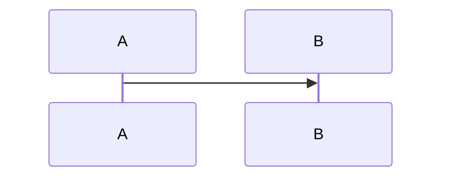

# Detailed Design — <Component Name>

**HLD reference:** [link]
**Version:** 0.1
**Status:** Draft

## 1. Component Responsibilities

## 2. Key Flows

## 3. Data Model

## 4. Error Handling Strategy

## 5. Performance Considerations
