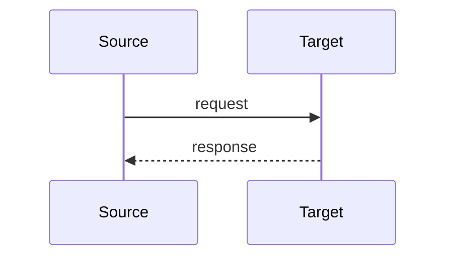

# Integration Pattern Catalog — <Project Name>

## <Pattern Name>: <Source> → <Target>

**Trigger:** <!-- when this integration activates -->
**Direction:** sync | async
**Protocol:** REST | MQ | SFTP | …

**Payload:** <!-- schema reference or description -->
**Error handling:** <!-- dead letter / retry policy -->
**NFR:** <!-- latency target, throughput -->

---
<!-- Repeat block above for each integration point -->
